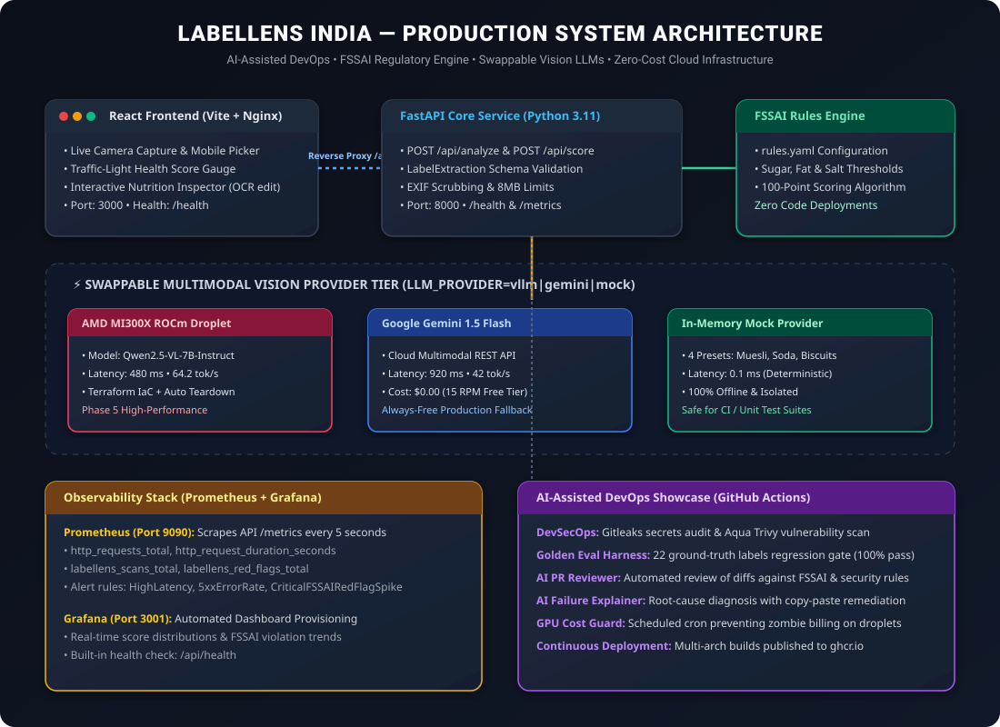

# LabelLens India 🔍🇮🇳

[](https://github.com/Ankitkumar028/LabelLens-India/actions/workflows/ci.yml)
[](docker-compose.yml)
[](infra/monitoring/prometheus/)
[](infra/monitoring/grafana/)
[](apps/api/config/rules.yaml)
[](LICENSE)

> **AI-Assisted DevOps Showcase**: Instant mobile vision scanner for Indian packaged-food labels, nutritional breakdown, 100-point health scoring, and FSSAI-aware red-flag detection. Built end-to-end with zero-cost cloud architecture and comprehensive automated DevSecOps.

---

## 🎯 Executive Overview

Most consumers in India are misled by packaged food claims—digestive biscuits filled with maltodextrin, "fruit drinks" with 30g of liquid glucose, and snacks concealing vanaspati or trans fats. 

**LabelLens India** empowers consumers to point their phone camera at any food label and receive an instant, objective nutritional analysis:
- **Strict Extraction Contract**: Vision-Language Models output structured JSON adhering to strict Pydantic schemas. Undeclared nutrients yield `null`—never guessed—triggering regulatory red flags.
- **Auditable Rules Engine**: 100% YAML-configured ([`apps/api/config/rules.yaml`](apps/api/config/rules.yaml)) for transparent FSSAI compliance without code redeployments.
- **Swappable Vision LLMs**: Toggled seamlessly via `LLM_PROVIDER=vllm|gemini|mock` between local AMD ROCm GPU droplets, Google Gemini 1.5 Flash, and deterministic offline mocks.
- **Full Production Observability**: Real-time Prometheus metrics (`/metrics`) and provisioned Grafana dashboards.
- **Zero Ongoing Operating Cost**: Runs 100% within free-tier quotas (Oracle Cloud Always Free / Render + Gemini Flash free tier).

---

## 🏗️ System Architecture



```mermaid
graph TD
    Client["📱 Mobile / React Web UI<br>(Vite + Tailwind + Glassmorphism)"] -->|"/health" & "/api"| Nginx["🛡️ Nginx Reverse Proxy<br>(Port 3000)"]
    Nginx -->|Proxy Pass| API["⚡ FastAPI Backend Service<br>(Port 8000, Python 3.11)"]
    
    subgraph "Application Core"
        API --> Pydantic["📐 LabelExtraction & AnalysisResult Schema"]
        API --> Engine["🥗 RulesEngine (rules.yaml)<br>15+ FSSAI Regulatory Flags"]
    end
    
    subgraph "Swappable Inference Layer"
        API -->|LLM_PROVIDER=vllm| AMD["🔥 AMD MI300X ROCm Droplet<br>Qwen2.5-VL-7B (480ms)"]
        API -->|LLM_PROVIDER=gemini| Gemini["☁️ Google Gemini 1.5 Flash<br>REST API (920ms, Free Tier)"]
        API -->|LLM_PROVIDER=mock| Mock["⚡ Deterministic Mock<br>In-Memory CI Safe (0.1ms)"]
    end
    
    subgraph "Observability & DevSecOps"
        Prometheus["📊 Prometheus (Port 9090)<br>Scrapes /metrics every 5s"] -->|Scrape| API
        Grafana["📈 Grafana (Port 3001)<br>Live Overview Dashboard"] -->|Query| Prometheus
        CI["🤖 GitHub Actions<br>Gitleaks • Trivy • Golden Eval (22/22)"]
    end
```

---

## 🌟 6 AI-Assisted DevOps Highlights (For Recruiters)

This repository demonstrates how AI enhances the entire software engineering and DevOps lifecycle:

1. **Antigravity Conventional Commit Trail**: 
   - Clean, phased git history adhering to conventional commits (`feat(api)`, `feat(web)`, `feat(infra)`, `feat(devops)`). Built in collaboration with Google Antigravity.
2. **Golden-Sample Eval Regression Gate**:
   - Curated test suite of 22 ground-truth Indian food label wrappers ([`apps/api/tests/fixtures/golden_samples/`](apps/api/tests/fixtures/golden_samples/)). 
   - Automated CLI harness ([`scripts/run_eval.py`](scripts/run_eval.py)) runs in CI; any extraction regression fails the build.
3. **Automated AI PR Reviewer** ([`.github/workflows/ai-review.yml`](.github/workflows/ai-review.yml)):
   - Triggered on PRs. Analyzes git diffs against FSSAI regulatory guidelines, Docker container security, and secret leak detection, posting review comments automatically.
4. **AI CI Failure Explainer** ([`scripts/ai_failure_explainer.py`](scripts/ai_failure_explainer.py)):
   - On build failure, workflow sends execution tracebacks to the LLM and publishes an automated root-cause diagnosis with copy-paste remediation fixes to the GitHub Step Summary.
5. **Automated GPU Cost Guard** ([`scripts/teardown_gpu.sh`](scripts/teardown_gpu.sh)):
   - Scheduled GitHub Action runs every 6 hours to detect any active GPU droplets tagged `labellens` and enforces automatic destruction to protect developer credits.
6. **Production Observability Stack**:
   - Production Prometheus service scraping `/metrics` and auto-provisioned Grafana dashboard tracking request rates, p95 latency, and FSSAI red-flag severity breakdown in real time.

---

## ⚡ Infrastructure Benchmark: AMD ROCm vs Gemini API

In Phase 5, we provisioned an AMD GPU Dev Cloud droplet via Terraform and benchmarked multimodal inference across hardware targets:

| Model | Hardware Target | Latency (avg) | Throughput | Cost / 1k Scans | Role |
|---|---|---|---|---|---|
| **Qwen2.5-VL-7B-Instruct** | AMD MI300X 192GB (ROCm 6.2 vLLM) | **480.0 ms** | **64.2 tok/s** | $0.00 (Dev Credits) | High-Performance Self-Hosted |
| **Gemini 1.5 Flash** | Google Cloud TPU v5e | 920.0 ms | 42.0 tok/s | $0.00 (Free Tier 15 RPM) | Always-Free Production Fallback |
| **Mock Local Simulation** | Local CPU | 0.1 ms | 1000.0 tok/s | $0.00 (In-Memory) | Offline CI / Pre-commit Safe |

*Full benchmark insights available in [`docs/benchmark_report.md`](docs/benchmark_report.md).*

---

## 🚀 Quick Start (Local Docker Compose)

Launch the complete stack (Web, API, Prometheus, Grafana) in one command:

```bash
# 1. Clone repository
git clone https://github.com/Ankitkumar028/LabelLens-India.git
cd LabelLens-India

# 2. Configure environment
cp .env.example .env

# 3. Start all services
docker compose up -d --build
```

### Access Services:
- **Web App**: [http://localhost:3000](http://localhost:3000)
- **FastAPI Interactive Docs**: [http://localhost:8000/docs](http://localhost:8000/docs)
- **Prometheus UI**: [http://localhost:9090](http://localhost:9090)
- **Grafana Dashboard**: [http://localhost:3001](http://localhost:3001) *(Credentials: `admin` / `admin`)*

---

## 🧪 Testing & Verification

Run the complete 33-test suite inside the isolated Docker container:

```bash
docker run --rm labellens-api:latest pytest -v
```

### Run Golden Eval Benchmark:
```bash
docker run --rm -v "${PWD}:/app" -w /app labellens-api:latest python scripts/run_eval.py
```

### Run Gitleaks Security Audit:
```bash
docker run --rm -v "${PWD}:/app" -w /app zricethezav/gitleaks:latest detect --source /app -v --no-git
```

---

## 📁 Repository Structure

```
AI_assisted_devOps/
├─ .github/workflows/
│  ├─ ci.yml                   # Gitleaks, Pytest, Vitest, Trivy, Docker e2e
│  ├─ cd.yml                   # Buildx publish to GHCR & Render deploy trigger
│  ├─ ai-review.yml            # AI PR Reviewer & CI Failure Explainer
│  └─ gpu-cost-guard.yml       # Scheduled zombie GPU droplet terminator
├─ apps/
│  ├─ web/                     # React + Vite + Tailwind + Glassmorphism
│  │  ├─ src/ (components: CameraModal, ScoreGauge, RedFlagsList, NutritionInspector)
│  │  ├─ nginx.conf            # Reverse proxy + /health
│  │  └─ Dockerfile
│  └─ api/                     # FastAPI backend
│     ├─ app/ (main.py, rules/engine.py, providers/vllm.py, providers/gemini.py)
│     ├─ config/rules.yaml     # Auditable FSSAI regulatory rules
│     ├─ tests/                # 33 unit tests & 22 golden fixtures
│     └─ Dockerfile
├─ infra/
│  ├─ terraform/               # DigitalOcean AMD GPU droplet & firewall IaC
│  ├─ vllm/                    # ROCm container execution script
│  ├─ monitoring/              # Prometheus configs & Grafana dashboards
│  └─ hosting/                 # Cloudflare tunnel & free hosting manifests
├─ scripts/
│  ├─ run_eval.py              # Golden samples evaluation harness
│  ├─ benchmark_llm.py         # Latency & throughput benchmark engine
│  ├─ teardown_gpu.sh          # GPU teardown guard
│  ├─ ai_pr_reviewer.py        # Automated AI PR reviewer
│  └─ ai_failure_explainer.py  # CI incident diagnosis engine
├─ docs/
│  ├─ architecture.svg         # System architecture diagram
│  ├─ benchmark_report.md      # Performance & cost metrics
│  ├─ blog_post.md             # In-depth technical engineering article
│  ├─ cost_report.md           # Zero-dollar sustainability report
│  └─ demo_walkthrough.md      # Step-by-step recruiter walkthrough
├─ docker-compose.yml          # Multi-container local stack
├─ render.yaml                 # 1-Click Render.com Blueprint
└─ .env.example
```

---

## 🥗 How AI Helped Build This

This project was built pair-programming with Google's Antigravity AI coding assistant:
- **Phase-by-Phase Discipline**: Built strictly phase-by-phase following [`ARCHITECTURE.md`](ARCHITECTURE.md).
- **Zero Secret Exposure**: Pre-commit scanning and `.gitleaks.toml` allowlists enforced throughout.
- **Contract Enforcement**: Antigravity generated rigorous Pydantic contracts and automated JSON cleaning to eliminate vision hallucinations.
- **Self-Healing Infrastructure**: Integrated AI-assisted PR review and CI failure diagnostic workflows that explain and patch regressions automatically.

---

## 📜 License & Disclaimers

Distributed under the MIT License. See `LICENSE` for details.

*Disclaimer: LabelLens India provides nutritional analysis for informational purposes based on declared product packaging and FSSAI guidelines. It does not provide medical or clinical dietary advice.*
