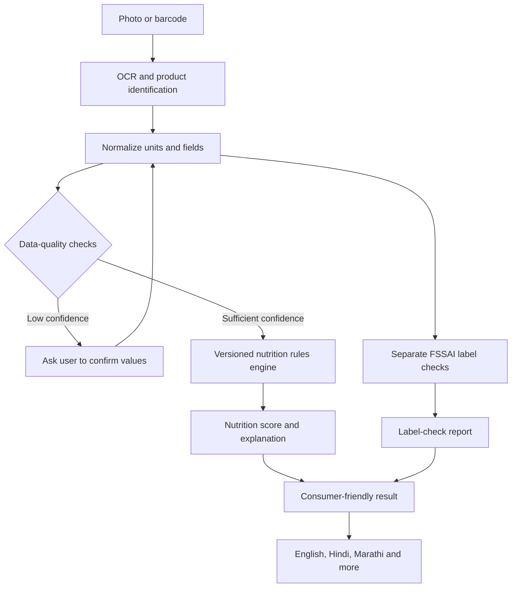

# LabelLens: Nutrition Intelligence & Trust Framework
## Product recommendations for an evidence-based nutrition guide for India

**Document type:** Product and scoring methodology proposal  
**Status:** Draft for product, engineering, and nutrition-expert review  
**Purpose:** Help LabelLens guide Indian consumers toward better-informed packaged-food choices using transparent, evidence-based nutrition information.

---

## 1. Executive recommendation

Position LabelLens as an **evidence-based food intelligence platform**, not merely a food-scoring app.

Use three separate foundations:

1. **Global public-health guidance:** WHO recommendations for healthy diets.
2. **Indian regulatory requirements:** Applicable FSSAI rules for packaged-food labels.
3. **Indian consumer context:** Relevant Indian dietary guidance, familiar foods, realistic serving sizes, affordability, and local languages.

Keep nutrition quality, label-compliance checks, and data confidence separate. A product should not receive a worse nutrition score simply because the app cannot read its licence number or allergen declaration.

The main product promise should be:

> Scan a food label. Understand what matters. Make a better-informed choice.

## 2. Principles for a trustworthy product

- **Evidence before scoring:** Every rule should have a documented source, rationale, version, and applicability.
- **Explainability:** Users should be able to understand why a score or warning appeared.
- **No false certainty:** Distinguish “not detected in this image” from “confirmed missing.”
- **Food context matters:** Interpret nutrition values in relation to serving size, food category, and the wider diet.
- **No fear-based messaging:** Avoid calling a food dangerous or high-risk solely because of a proprietary score.
- **Inclusive design:** Make results understandable in English, Hindi, Marathi, and progressively more Indian languages.
- **Respect uncertainty:** Never assume an unreported nutrient is zero.
- **Expert review:** Have qualified nutrition professionals review the scoring model before public release.

## 3. Three separate result areas

### A. Nutrition quality

Assess the nutrition characteristics that can be reliably extracted, such as:

- Energy
- Sodium
- Total and saturated fat
- Trans fat, when declared
- Total and added sugars, where available
- Carbohydrates
- Protein
- Dietary fibre

The interpretation should be appropriate to the food category and the intended use of the score. A breakfast cereal, cooking oil, beverage, and snack should not necessarily be evaluated using identical thresholds.

### B. Label and regulatory checks

Check applicable requirements under current FSSAI regulations, including relevant label elements such as:

- FSSAI logo and licence/registration number
- Ingredient list
- Nutrition declaration
- Allergen declarations
- Vegetarian/non-vegetarian symbol
- Date marking and other applicable declarations

These checks should produce a **separate compliance report**, not automatic nutrition-score deductions. Requirements can depend on product type, packaging, exemptions, and the current regulation. A potential issue should be reviewed before being described as a confirmed violation.

### C. Scan confidence and data quality

Tell the user whether the app could confidently read the label.

Suggested statuses:

- **Detected:** The item is visible and extracted.
- **Not detected in this image:** The app could not locate it in the supplied image.
- **Needs confirmation:** OCR found a possible value, but confidence is low.
- **Verified:** The value has been checked against a reliable source or user-confirmed image.
- **Not applicable:** The field does not apply to this product, where this can be established.

Do not silently convert missing data to zero or treat an OCR failure as proof of non-compliance.

## 4. Recommended scoring approach

A 0–100 nutrition score can be useful if its methodology is published and validated. However, WHO's healthy-diet recommendations are not, by themselves, a universal packaged-food scoring formula.

### Proposed design

- Keep a **Nutrition Score (0–100)** for nutritional composition.
- Show **Label Checks** separately.
- Show **Scan Confidence** separately.
- Optionally provide **personalized context**, with careful safeguards and without diagnosing disease.

Before assigning points, specify:

1. Product categories and why each category needs its own rules.
2. Nutrients included and excluded.
3. Per-100 g / per-100 ml versus per-serving interpretation.
4. Reference population and dietary assumptions.
5. Thresholds, weights, caps, bonuses, and penalties.
6. Treatment of missing, rounded, contradictory, or implausible values.
7. How the score handles products with different purposes (for example, cooking oil versus cereal).
8. A documented validation and review process.

### Calculation integrity

The displayed calculation must exactly reproduce the final score.

For example, if the displayed components are:

- Base: +100
- Compliance deduction: -20
- Nutrient adjustments: -48.2

then the shown result is 31.8, which rounds to 32.

If the nutrient adjustments are shown as:

- Sugar: -7.2
- Saturated fat: -3.8
- Sodium: -52.2
- Fibre bonus: +10

these sum to **-53.2**, not -48.2. Unless another +5 adjustment is clearly disclosed, the interface contains a calculation discrepancy. The proposed architecture should calculate the score and the breakdown from the same underlying adjustment records.

### Avoid misleading labels

Do not use terms such as “high health risk,” “unsafe,” or “dangerous” based only on an unvalidated proprietary score. Prefer clear, bounded explanations such as:

- “Higher in sodium compared with the selected reference”
- “This serving contributes approximately X% of the daily reference”
- “Lower-sodium alternatives may be worth comparing”
- “Score is based on the information detected on this label”

Any grade bands (for example, green/yellow/red) should be tested for comprehension and not imply a medical diagnosis or regulatory determination.

## 5. WHO and Indian guidance

Use WHO healthy-diet guidance as a global public-health foundation. Incorporate current applicable Indian guidance and FSSAI regulations for local and regulatory context.

Potential adult reference points from WHO healthy-diet guidance include:

- Sodium: less than 2,000 mg/day.
- Free sugars: less than 10% of daily energy, with a conditional recommendation to reduce to 5% or less.
- Saturated fat: less than 10% of daily energy.
- Trans fat: less than 1% of daily energy.
- Dietary fibre: at least 25 g/day of naturally occurring fibre for people over age 10.
- Fruit and vegetables: at least 400 g/day for people over age 10.

**Important limitations:**

- These are daily dietary recommendations, not automatically suitable per-product thresholds.
- “Free sugars” are not identical to total sugars; label data may not permit a precise free-sugar estimate.
- Daily reference points vary by age, health context, energy needs, and other factors.
- Validate the interpretation with qualified experts and cite the specific guidance version in the product.
- Verify the latest FSSAI regulations and Indian dietary recommendations before release.

Reference starting points:

- WHO healthy diet fact sheet: https://www.who.int/news-room/fact-sheets/detail/healthy-diet
- FSSAI regulations portal: https://www.fssai.gov.in/food-law/regulations
- FSSAI Labelling and Display Regulations page: https://www.fssai.gov.in/food-law/regulations/amendments/labelling-display

## 6. Example: the oats-and-millet product

The supplied label extraction reported the following values per 100 g:

| Nutrient | Reported value |
|---|---:|
| Energy | 365 kcal |
| Protein | 8.8 g |
| Carbohydrates | 70.4 g |
| Total sugars | 6 g |
| Added sugars | 3.8 g |
| Total fat | 7.5 g |
| Saturated fat | 1.9 g |
| Trans fat | 0 g |
| Sodium | 2,089 mg |
| Dietary fibre | 9.7 g |

The package also reported a 38 g serving. Using the extracted values, that serving contains approximately:

| Nutrient | Approximate amount per 38 g |
|---|---:|
| Energy | 139 kcal |
| Protein | 3.3 g |
| Dietary fibre | 3.7 g |
| Total sugars | 2.3 g |
| Added sugars | 1.4 g |
| Sodium | 794 mg |

### Appropriate interpretation

- The fibre amount is a useful contribution.
- The protein amount is modest for a full meal.
- The reported sodium is the clearest nutritional concern: approximately 40% of the WHO adult daily sodium maximum in a 38 g serving.
- The reported added sugar is relatively low per serving.
- Maltodextrin is an ingredient worth explaining, but its presence alone does not prove excessive added sugar or make the product inherently unhealthy.
- Confirm extracted values against a clear image before making strong claims.

Do not present this example as a medical assessment or treat the app's proprietary score as an established scientific rating.

## 7. Ingredient and sugar-derivative detection

Ingredient interpretation should be precise and avoid alarmist shortcuts.

- Distinguish sugars, syrups, starches, maltodextrin, and other carbohydrate ingredients.
- Do not treat all of these as interchangeable or automatically count them as declared added sugar.
- Preserve ingredient order and percentages where legible.
- Explain what an ingredient is and why it may matter, without assuming its amount if the label does not disclose it.
- Do not infer glycaemic response or a clinical outcome from the ingredient list alone.
- Use controlled ingredient dictionaries with reviewed synonyms and language variants.

A better alert might say:

> “Maltodextrin detected. This is a digestible carbohydrate ingredient. Its presence alone does not tell us the total glycaemic effect of the food.”

## 8. Recommended technical architecture

### Engineering requirements

- Normalize nutrition values to standard units and retain original label values.
- Store per-100 g / per-100 ml and per-serving values separately.
- Store OCR confidence, source image reference, user corrections, and product-data provenance.
- Keep nutrition rules deterministic and version controlled.
- Let AI help explain results, but do not let a language model invent or silently change score calculations.
- Use a single scoring result object to generate both the final score and its visible breakdown.
- Log which rule version produced each result.
- Add regression tests for missing fields, unit conversions, rounding, conflicting data, and score boundaries.
- Support correction reports and updates to product records.
- Protect uploaded images and personal data with clear retention and privacy policies.

## 9. Suggested development roadmap

### Phase 1 — Trust and correctness

- Fix the scoring arithmetic mismatch.
- Separate nutrition scoring from compliance findings.
- Implement “not detected” versus “confirmed missing.”
- Add confidence levels to OCR-extracted fields.
- Show the score calculation in full.

### Phase 2 — Evidence and expert review

- Document the nutrition model and each threshold.
- Review it with qualified nutrition professionals.
- Map applicable FSSAI checks to the current regulation and any relevant exemptions.
- Test how consumers understand scores, warnings, and alternatives.

### Phase 3 — Indian product coverage

Build a diverse test dataset covering packaged snacks, biscuits, cereals, instant noodles, drinks, dairy products, and ready-to-eat meals. Include different brands, languages, package layouts, and image quality levels.

### Phase 4 — Consumer education

- Provide concise explanations in Indian languages.
- Compare products on a like-for-like basis, using per-100 g values and realistic serving sizes.
- Offer lower-sodium or otherwise more suitable alternatives when reliable data exists.
- Explain trade-offs rather than declaring a single product universally good or bad.

### Phase 5 — Transparency and continuous improvement

- Publish methodology, sources, limitations, and rule versions.
- Monitor OCR accuracy and false-positive rates.
- Provide an easy mechanism for users to report errors.
- Re-review rules as authoritative guidance and regulations change.

## 10. Success metrics

Track whether LabelLens is accurate and useful, not just whether people scan products.

Suggested metrics:

- OCR field accuracy for nutrition values and ingredient order.
- Percentage of scores whose displayed arithmetic exactly reconciles.
- False-positive and false-negative rates for label warnings.
- Agreement with expert-reviewed product assessments.
- Percentage of results with clear source and rule-version provenance.
- Consumer comprehension of key warnings.
- Successful scans across Indian languages and packaging types.
- User-reported corrections and time taken to resolve them.

Set targets after establishing a baseline with a representative test set. Do not claim scientific validation until the methodology has actually been evaluated.

## 11. Governance and safeguards

- Do not market the score as a medical diagnosis or substitute for professional advice.
- Avoid declaring a product unsafe or non-compliant from an incomplete image alone.
- Make uncertainty visible.
- Provide separate guidance for general consumers and optional health-related contexts, with appropriate safeguards.
- Have qualified experts review public-health claims and changes to scoring rules.
- Maintain an auditable history of rule changes.

## 12. Final recommendation

**Build LabelLens around three promises: accuracy, transparency, and practical education.**

1. **Accuracy:** Correct extraction, sound calculations, and current authoritative references.
2. **Transparency:** Explain what was detected, what remains uncertain, and exactly how a score was produced.
3. **Practical education:** Help people understand portions, nutrients, and realistic alternatives in their preferred language.

The goal should not be to make consumers afraid of packaged food. It should be to help them compare products, understand meaningful nutritional trade-offs, and make better-informed choices.

---

*This document is a product proposal, not an official WHO or FSSAI scoring standard. All rules, thresholds, compliance checks, and public claims should be verified against current authoritative sources and reviewed by qualified professionals before release.*
